# TechNova Solutions — Windows 11 User Management & NTFS Permissions Lab

## Project Overview

This hands-on lab simulates a small business IT environment for a fictional company called **TechNova Solutions**.

The objective was to configure local Windows user accounts, organize employees into departmental security groups, implement NTFS folder permissions, and validate access controls through practical testing.

The lab demonstrates foundational skills relevant to IT Support, Desktop Support, and Junior System Administrator roles.

## Lab Environment

- **Operating System:** Windows 11 Pro
- **Virtualization:** VMware Workstation
- **Computer Name:** PC01
- **Management Tools:** Local Users and Groups, File Explorer, Command Prompt
- **Security Model:** Local security groups and NTFS permissions

## 1. Local User Account Management

Created three local user accounts representing employees from different departments.

| Username | Full Name | Department |
|---|---|---|
| Adrian.Sales | Adrian Rodriguez | Sales |
| Brian.HR | Brian Martinez | Human Resources |
| Carlos.IT | Carlos Hernandez | IT Support |

Accounts were managed using `lusrmgr.msc`.

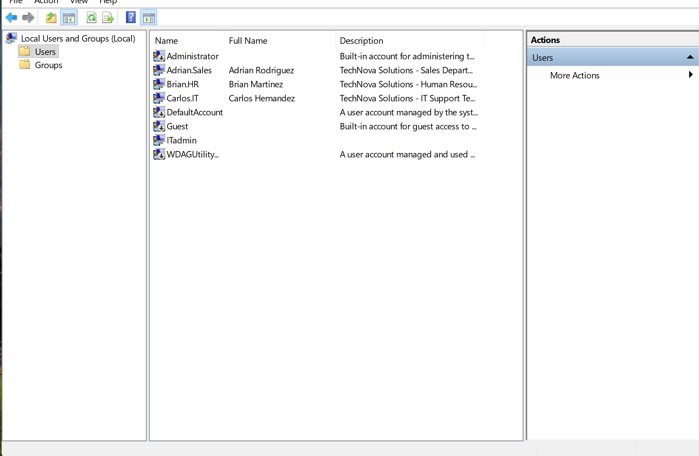

## 2. Security Group Configuration

Created three local security groups to manage departmental access.

| Security Group | Assigned Employee |
|---|---|
| Sales_Department | Adrian.Sales |
| HR_Department | Brian.HR |
| IT_Department | Carlos.IT |

Group membership was configured using Windows Local Users and Groups.

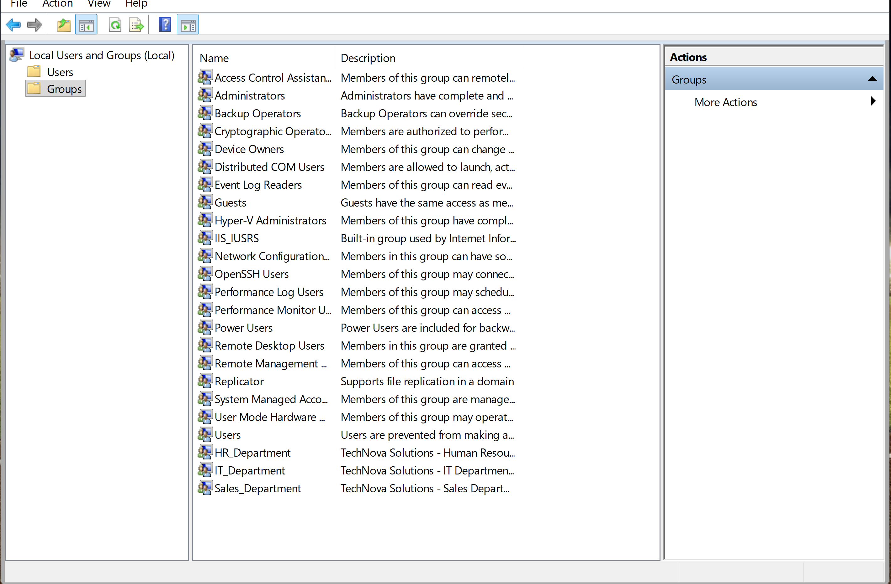

Additional group membership evidence:

- [Security Group Screenshot A](Screenshots/Security-Groups/a.png)
- [Security Group Screenshot B](Screenshots/Security-Groups/b.png)
- [Security Group Screenshot C](Screenshots/Security-Groups/c.png)

## 3. Department Folder Structure

Created a centralized company folder with separate directories for each department.

```text
C:\TechNova Solutions\
├── IT\
├── HR\
└── SALES\
```

This structure simulates departmental file organization in a business environment.

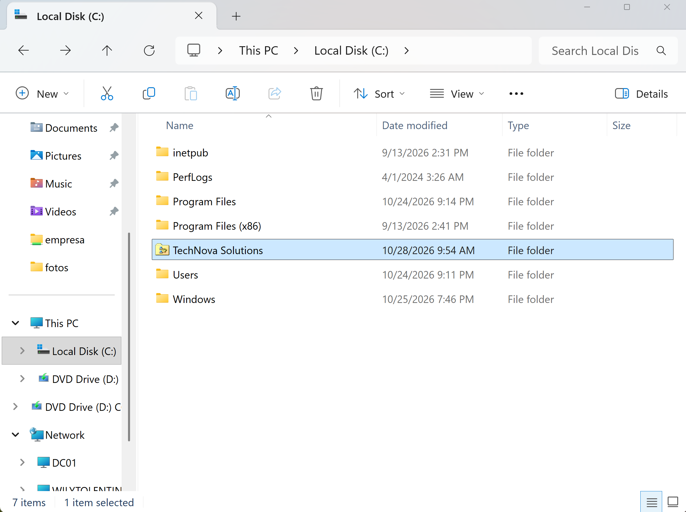
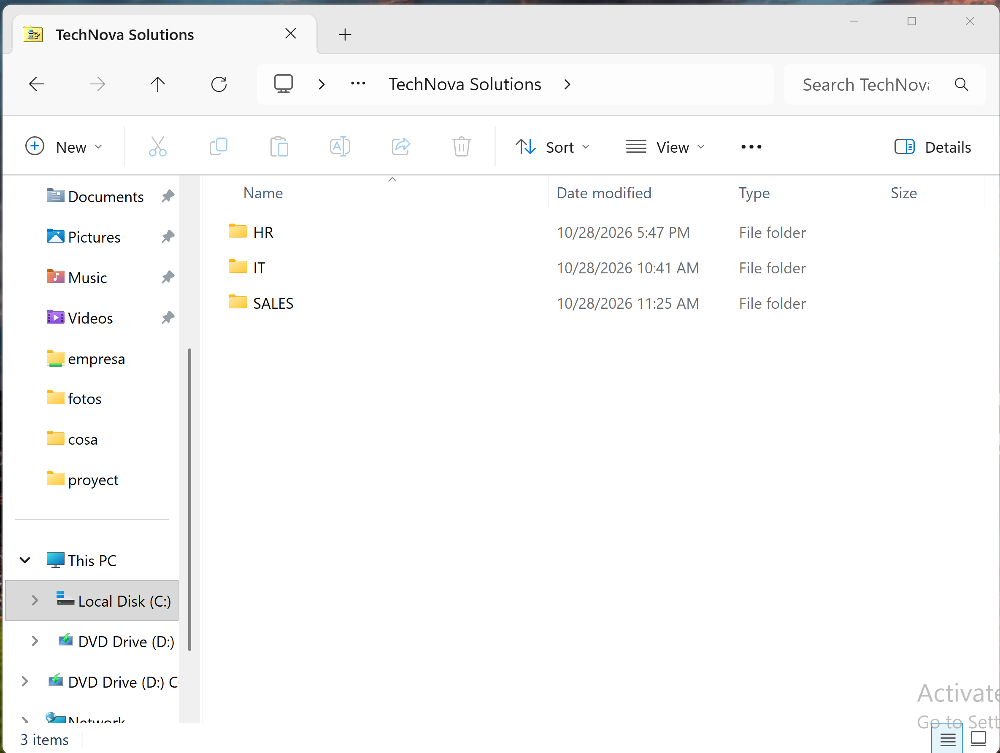

## 4. NTFS Permissions Configuration

Configured NTFS permissions to provide department-specific access.

| Folder | Authorized Group | NTFS Permission |
|---|---|---|
| IT | IT_Department | Modify |
| HR | HR_Department | Modify |
| SALES | Sales_Department | Modify |

The **Modify** permission allows authorized employees to read, create, edit, and delete files within their assigned department folders.

Administrative and SYSTEM access was retained for system management.

### Permission Configuration Evidence

**IT Department**

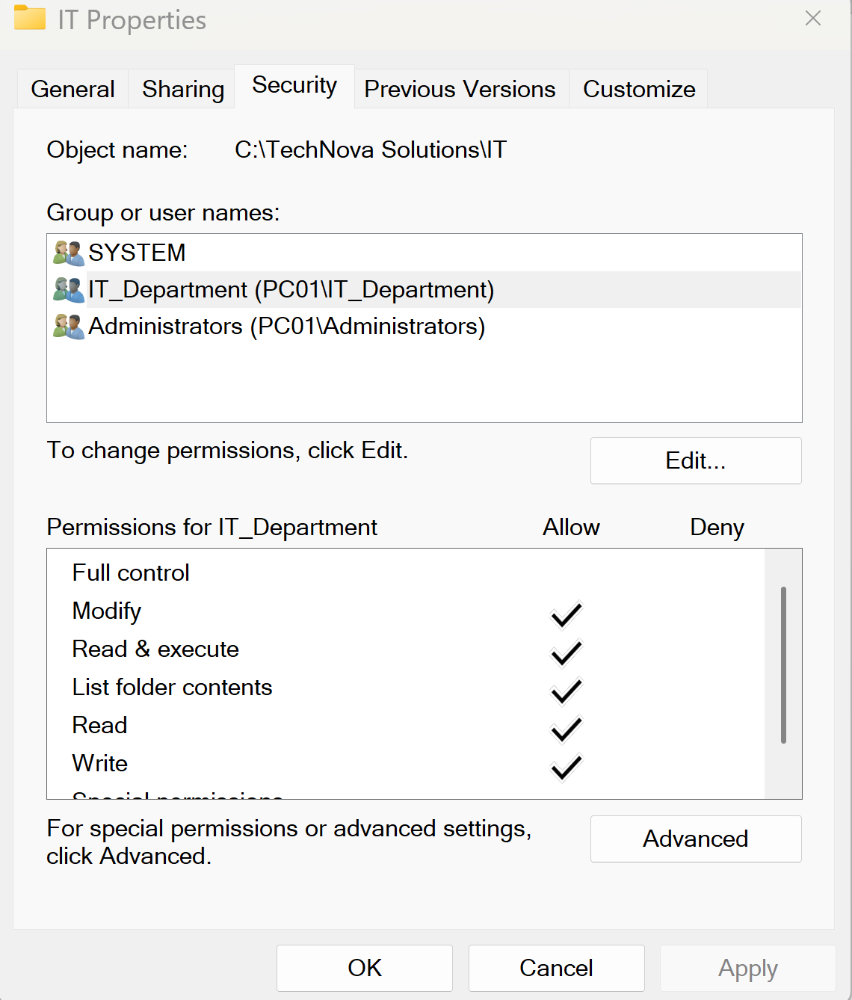

**Human Resources**

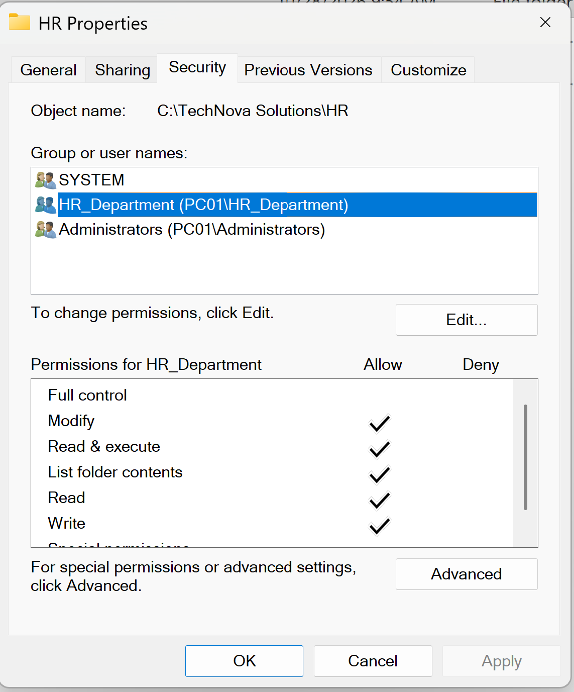

**Sales Department**

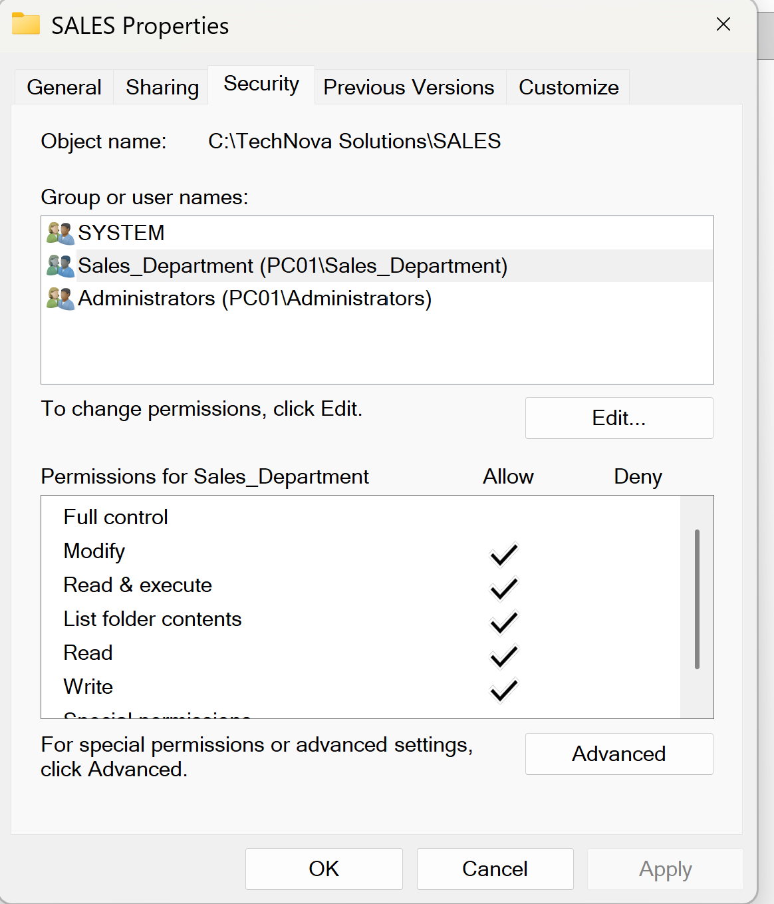

## 5. Access Control Validation

Performed practical access tests by signing in with different local user accounts.

The goal was to verify that employees could access their own departmental folders while being restricted from unauthorized folders.

### Test Results

| User | Target Folder | Expected Result |
|---|---|---|
| Adrian.Sales | SALES | Access Granted |
| Adrian.Sales | IT | Access Denied |
| Brian.HR | HR | Access Granted |
| Brian.HR | SALES | Access Denied |
| Carlos.IT | IT | Access Granted |
| Carlos.IT | HR | Access Denied |

### Adrian — Sales Department

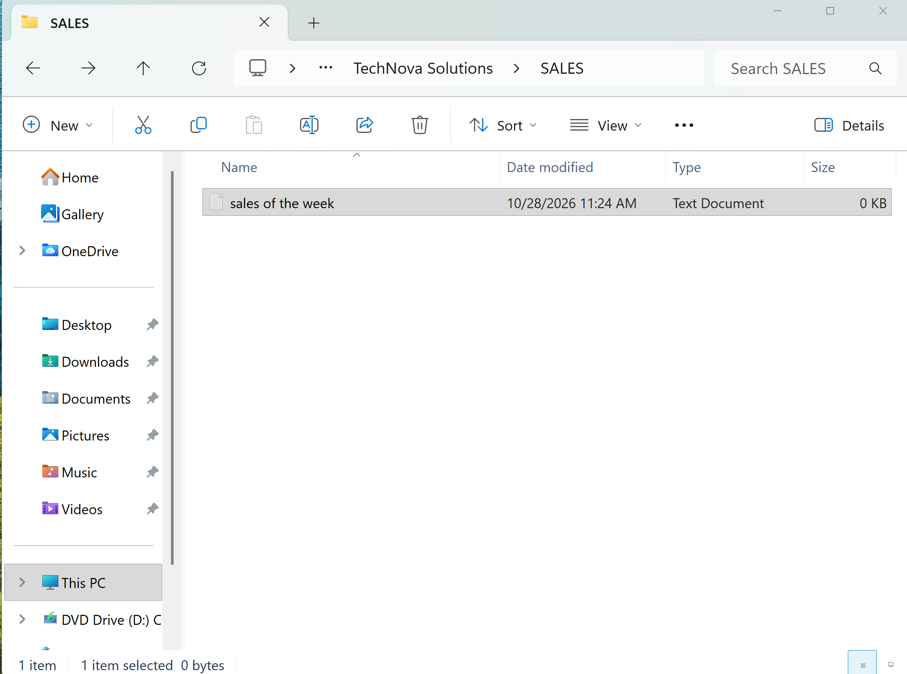

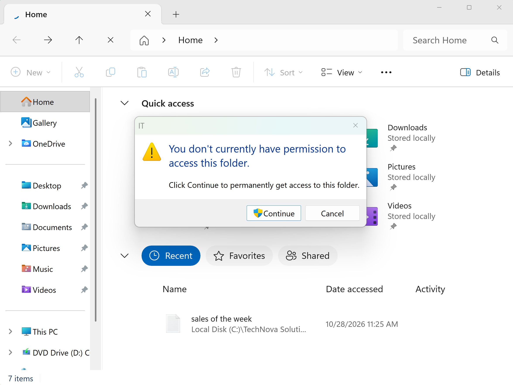

### Brian — Human Resources

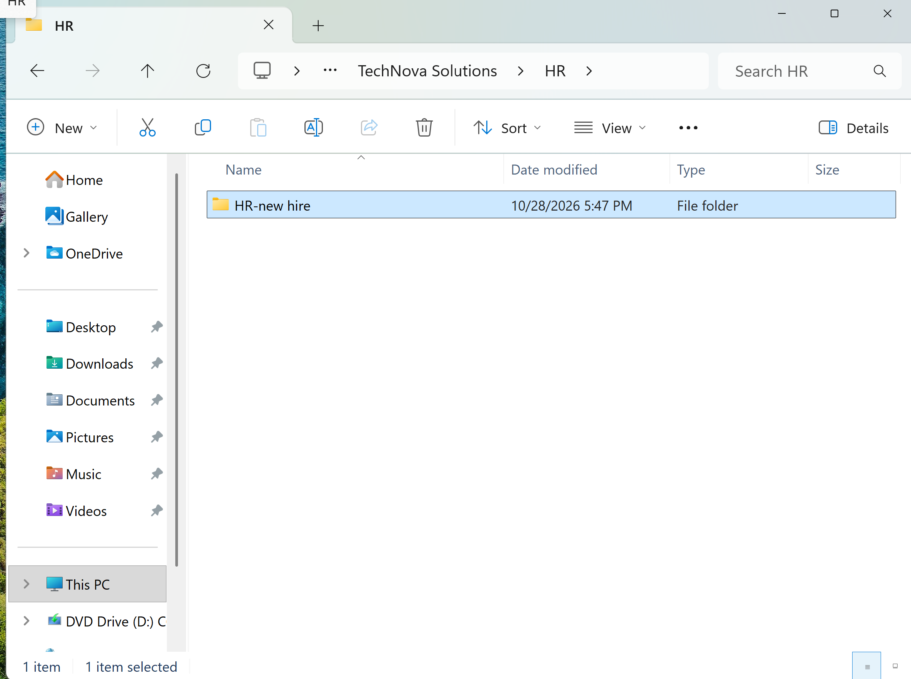

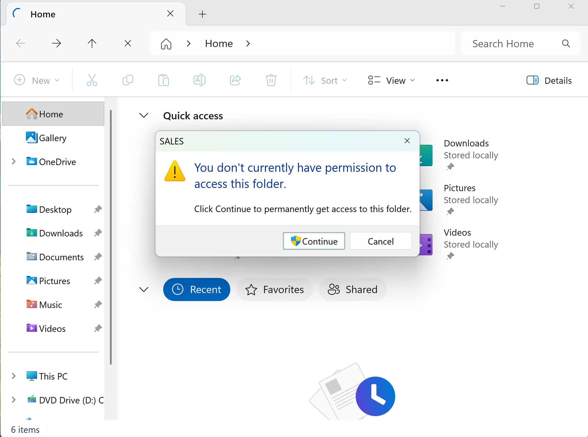

### Carlos — IT Department

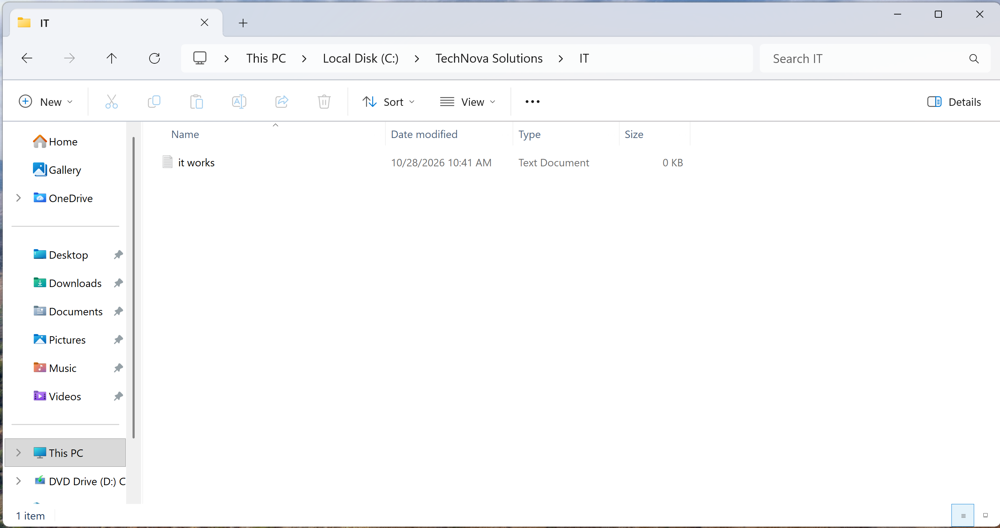

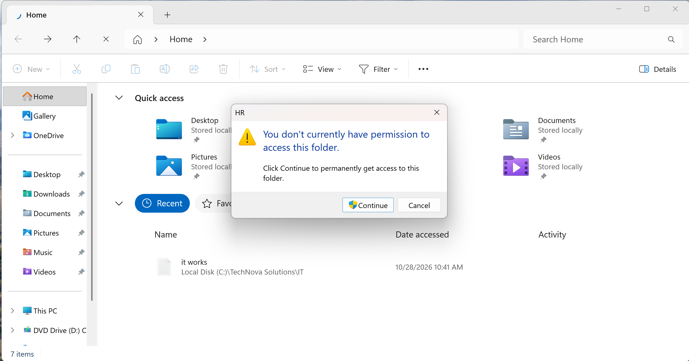

## 6. Troubleshooting and Diagnostics

During access testing, an incorrect folder path initially caused confusion when attempting to access a departmental directory.

The issue was investigated using Windows command-line tools.

**Commands used:**

```cmd
whoami /groups
```

Verified the active user's security group membership.

```cmd
icacls "C:\TechNova Solutions\IT"
```

Inspected NTFS permissions assigned to the IT directory.

```cmd
dir "C:\TechNova Solutions\IT"
```

Verified the target directory and inspected its contents.

The issue was resolved after confirming and correcting the folder path.

This troubleshooting exercise reinforced the importance of validating file paths, user identities, security group memberships, and effective permissions before modifying security settings.

## 7. Security Principles Applied

**Principle of Least Privilege:** Employees were assigned access based on departmental responsibilities.

**Group-Based Access Control:** NTFS permissions were assigned to security groups rather than managed separately for each employee.

**Access Validation:** Authorized and unauthorized access scenarios were tested using different Windows accounts.

**Security Documentation:** Screenshots were collected to document configurations and test outcomes.

## 8. Skills Demonstrated

- Windows 11 local user administration
- Local security group creation and membership management
- NTFS permission configuration
- Department-based access control
- Least privilege implementation
- Windows security troubleshooting
- Command Prompt diagnostics
- Technical documentation
- GitHub portfolio management

## Conclusion

This lab provided practical experience configuring and validating local Windows security controls in a simulated business environment.

The project strengthened foundational skills in user administration, security groups, NTFS permissions, access validation, and troubleshooting.

These skills are directly applicable to entry-level IT Support and Junior System Administrator responsibilities.

---

**Project:** TechNova Solutions — Windows 11 User Management & NTFS Permissions Lab

**Environment:** Windows 11 Pro | VMware Workstation

**Focus:** Windows Administration | NTFS Security | Access Control | Troubleshooting
