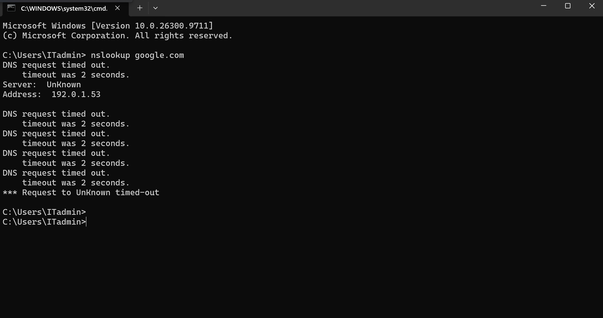
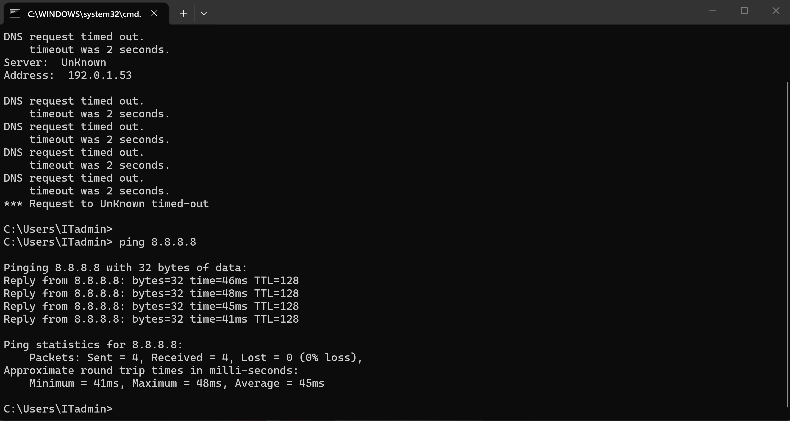
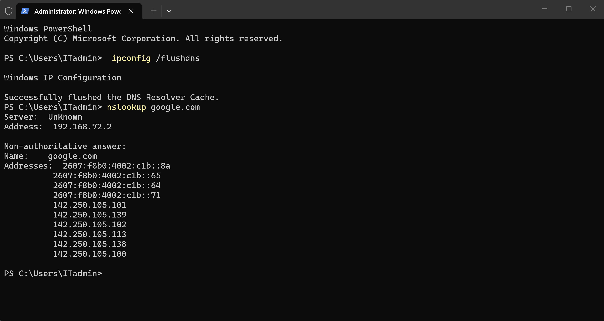
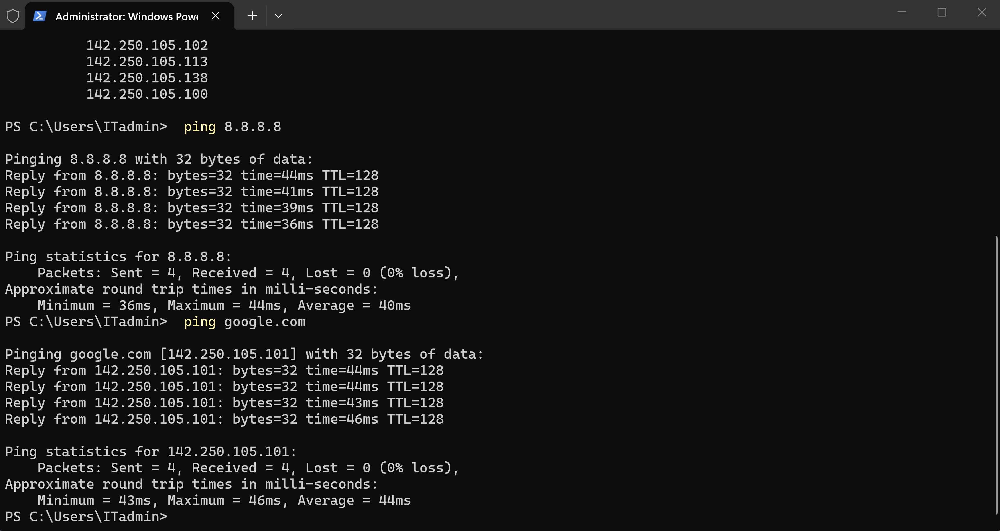

# TechNova IT Support — Ticket #1041

## Windows 11 Network & DNS Troubleshooting

### Ticket Information

- **Ticket ID:** INC-1041
- **Category:** Network Connectivity / DNS Troubleshooting
- **Environment:** Windows 11 Pro (PC01), VMware Workstation
- **Priority:** Medium
- **Status:** Resolved

## 1. Problem Description

A TechNova employee reported that their workstation was experiencing DNS resolution problems, preventing reliable access to websites and online resources.

The IT Support team was assigned to investigate the network configuration, identify the root cause, and restore connectivity.

## 2. Lab Environment

- **Client Computer:** PC01 — Windows 11 Pro
- **Virtualization Platform:** VMware Workstation
- **Network Configuration:** NAT
- **DNS Server (Working Configuration):** 192.168.72.2
- **Simulated Incorrect DNS Server:** 192.0.1.53

## 3. Troubleshooting Steps

### Step 1 — Verify Network Connectivity

Executed the following command:

```powershell
ping 8.8.8.8
```

**Result:** Successful replies with 0% packet loss.

This confirmed that the workstation had basic IP connectivity.

### Step 2 — Test DNS Resolution

Executed:

```powershell
nslookup google.com
```

**Result:** DNS request timed out.

This indicated that the workstation could reach external IP addresses but could not successfully resolve domain names.

### Step 3 — Identify the Root Cause

Reviewed the workstation's DNS configuration.

The DNS server was incorrectly configured as:

```text
192.0.1.53
```

This server was not responding to DNS requests in the lab environment.

### Step 4 — Correct the DNS Configuration

Updated the DNS server address to:

```text
192.168.72.2
```

This restored the DNS configuration used by the VMware NAT network.

### Step 5 — Clear the DNS Resolver Cache

Opened PowerShell with administrator privileges and executed:

```powershell
ipconfig /flushdns
```

This cleared the local DNS resolver cache.

### Step 6 — Verify the Resolution

Executed:

```powershell
nslookup google.com
ping google.com
ping 8.8.8.8
```

**Result:** DNS resolution and connectivity tests completed successfully.

## 4. Root Cause

The workstation had an incorrect DNS server configuration, causing DNS queries to time out.

Basic IP connectivity was functioning, but hostname resolution was failing.

## 5. Resolution

Corrected the DNS server configuration, cleared the DNS resolver cache, and verified successful hostname resolution and network connectivity.

**Final Status: Resolved**

## 6. Technical Skills Demonstrated

- Windows 11 network troubleshooting
- TCP/IP fundamentals
- DNS configuration and name resolution
- Command Prompt and PowerShell
- `ping`, `nslookup`, and `ipconfig`
- Root cause analysis
- Incident documentation
- Post-resolution verification

## 7. Evidence

## 7. Evidence

### DNS Resolution Failure


### IP Connectivity Test


### DNS Resolution Restored


### Final Connectivity Verification


## 8. Lessons Learned

A workstation can have working IP connectivity while DNS resolution fails.

Testing IP connectivity and hostname resolution separately helps isolate the problem and avoid unnecessary changes to the network configuration.

---

**Project:** TechNova IT Support Lab  
**Ticket:** INC-1041  
**Platform:** Windows 11 Pro / VMware Workstation  
**Purpose:** Hands-on IT Support and Junior System Administrator portfolio
